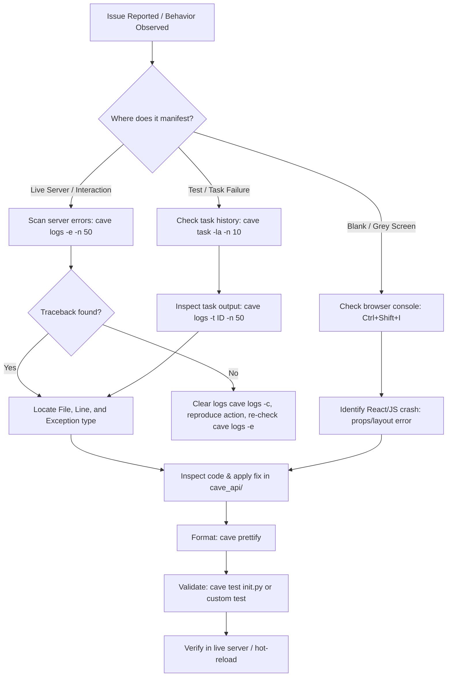

# Debugging and Error Resolution

This skill covers tracing, detecting, and resolving all types of errors (live server exceptions, background task failures, schema validation failures, database sync issues, and browser console errors) in CAVE.

---

## 1. Quick Debugging Reference

| Goal | Command / Action | Why & Best Practice |
|---|---|---|
| **Scan Live Server Errors** | `cave logs -e` | Filters server logs to only errors and exceptions. Highly token-efficient. |
| **Inspect Recent Server Logs** | `cave logs -n 20` | Shows the last 20 lines of the server log. Add `-e` or `-w` for errors/warnings. |
| **Follow Live Server Output** | `cave logs -f` | Real-time stream of server activity. Press `Ctrl+C` to detach. |
| **List Running Containers** | `cave list` | Lists running CAVE app and task runner containers. Never run `docker ps`. |
| **Inspect Environment Health** | `cave doctor` | Verifies Docker daemon, dependencies, and environment status. |
| **View Task History & Status** | `cave task -la -n 10` | Lists the last 10 background tasks (tests, prettify, custom runs) with exit status. |
| **Inspect Background Task Logs** | `cave logs -t [ID] -n 50` | Views logs for the latest (or specific ID) task without entering an interactive session. |
| **Attach to Running Task** | `cave task attach [ID]` (or `-a`) | Interactively stream logs for an active task (`Esc` to detach, `Ctrl+C` to cancel). |
| **Clear Server Logs** | `cave logs -c` | Clears target log file before reproducing a bug to keep new logs concise. |
| **Manual Schema Validation** | `cave prettify && cave test init.py` | Runs `Validator` against your `init` output and prints structured issues. |
| **Live Schema Validation** | Set `LIVE_API_VALIDATION_PRINT=true` in `.env` | Logs real-time schema validation reports on every user interaction. |
| **Browser Console** | `Ctrl+Shift+I` → Console tab | Grey/blank screen after `init` usually indicates a frontend React/JS crash. |

> [!CAUTION]
> **No Raw Docker or Host Python Invocations During Debugging:**
> - **Never run raw `docker` or `docker compose` commands** (`docker ps`, `docker logs`, `docker exec`). Use `cave list`, `cave logs`, `cave doctor`, or `cave task` instead.
> - **Never try to import or inspect project packages (`cave_utils`, `pamda`, `django`) directly with host Python** (e.g. `python3 -c "import ..."`). All dependencies are installed exclusively inside Docker containers; testing or inspecting them from the host shell will fail. Always use `cave test <file>` or `cave task start <command>`.

---

## 2. Inspecting Live Server Logs (`cave logs`)

When an error occurs during runtime (e.g., when a user interacts with a widget, clicks a button, or triggers a custom command), the exception is logged to the server logs (`run.log`).

Instead of reading large log files directly or restarting the server in verbose mode, use `cave logs`:

### A. Token-Efficient Error Scanning
Always prefer targeted log queries to avoid consuming excessive tokens in conversational context:

```sh
# Scan for errors and exceptions only (most token-efficient):
cave logs -e

# Include warnings along with errors:
cave logs -e -w

# Limit to the last 20 or 50 lines:
cave logs -n 20
cave logs -e -n 50
```

### B. Following Real-Time Server Activity
```sh
# Follow live server output:
cave logs -f

# Follow only errors and warnings in real time:
cave logs -f -e -w
```

### C. Log Path and Log Management
```sh
# Print the absolute path to the active server log file (useful for external tooling):
cave logs -p

# Clear the log file before triggering a specific action so only relevant logs are captured:
cave logs -c
```

### D. Full / Raw Logs (`cave run --all`)
If you require raw container stdout/stderr (e.g., container boot messages or unnormalized streaming output), start or restart the app with `--all`:
```sh
cave run --all
```
* Bypasses the TUI dashboard to stream logs directly.
* Note: `cave logs` reads from the rotating log file created by `cave run` (controlled by `--log-history` and `--log-lines <N>`, default 500 lines).

---

## 3. Inspecting Background Tasks & Test Failures (`cave task` & `cave logs -t`)

Background tasks (automated tests like `cave test`, code formatting via `cave prettify`, or custom commands via `cave task start`) execute sequentially in an isolated container.

When a task fails or produces unexpected results:

### Step 1: List Recent Tasks
Check task statuses and find the task ID:
```sh
# List all recent tasks with status (Completed, Failed, Cancelled):
cave task -la -n 10
```

### Step 2: Inspect Task Logs Non-Interactively
Use `cave logs -t` to read the task output directly without blocking or opening an interactive session:
```sh
# Inspect output of the most recent task:
cave logs -t -n 50

# Inspect output of a specific task ID:
cave logs -t 3 -n 50
```

### Step 3: Attach Interactively (Optional)
If a task is actively running and you want to follow it live:
```sh
cave task attach [ID]
# Press Esc to detach and leave it running, or Ctrl+C to cancel
```

---

## 4. Step-by-Step Troubleshooting Workflow



1. **Locate the Problematic Code**:
   - Trace the file and line number from the bottom of the Python traceback (e.g., in `cave_api/src/app.py` or `cave_api/examples/...`).
   - Match the active `command` passed to `execute_command`.
2. **Verify Schemas**:
   - Always run `cave prettify` followed by `cave test init.py` (see [lint](../lint/SKILL.md) and [test](../test/SKILL.md)).
   - Verify that your changes conform to the correct property formats in the [api-reference](../api-reference/SKILL.md) skill.
3. **Fix and Validate**:
   - Edit the code. CAVE's server automatically hot-reloads Python changes without needing a full container restart.
   - Run `cave prettify && cave test <test_file.py>` to verify that tests pass cleanly.

---

## 5. Common Errors and Solutions

| Error Sign / Message | Probable Cause | How to Fix |
|---|---|---|
| `Exception: Test Exception!` | Pressed the simulated "Outlined Button Example" | None. Built-in demo error triggered from [kitchen_sink.py](../../cave_api/examples/kitchen_sink.py). |
| `KeyError: '...'` | Accessing a missing key in `session_data` (e.g. `session_data['panes']['data']`) | Check if key exists using `.get()` or check initial dictionary in `init.py`. |
| `AttributeError: 'NoneType' object has no attribute '...'` | Expecting an object but received `None` | Add defensive checks (`if obj is not None:`) before reading properties. |
| Page loads with blank/grey screen | Frontend JavaScript runtime crash | Open Chrome DevTools (`Ctrl+Shift+I`) → **Console** tab. Identify the React/JS error (often caused by invalid nested layout values or missing required props). Refer to the [layout-design](../layout-design/SKILL.md) skill. |
| Server hangs on boot / doesn't respond | DB migration or container lock issue | Inspect recent logs with `cave logs -n 50`. If stuck, stop with `cave kill` or reset with `cave reset` (destructive, ask user first). |

---

## 6. Proactive Debugging and Surfacing Bugs

To detect hidden issues early or assist in tracing unknown bugs during development:

### A. Context-Rich Exceptions
Avoid allowing the app to fail silently or crash with generic `NoneType` or `KeyError` messages downstream. Raise descriptive exceptions capturing state:
```python
if "my_key" not in session_data:
    raise KeyError(
        f"Missing critical key 'my_key' in session_data. Current keys: {list(session_data.keys())}"
    )
```

### B. Live Logging and State Inspection
Take advantage of hot-reloading by adding debug prints:
```python
print(f"DEBUG: execute_command triggered with command={command}")
print(f"DEBUG: Current session keys: {list(session_data.keys())}")
```
Inspect them instantly using `cave logs -n 20` or follow live with `cave logs -f`.

### C. Inline Validation Checks
Validate results programmatically in custom commands before returning to client:
```python
from cave_utils import Validator

validator = Validator(session_data, ignore_keys=["meta"])
if len(validator.log.log) > 0:
    validator.log.print_logs()
    socket.notify(
        message="A schema mismatch was detected. Check server logs.",
        title="Schema Warning",
        theme="warning",
    )
```

### D. Mutation Log Capture & Custom Replay Tests
If a bug only triggers after a specific sequence of user interactions:
1. Capture frontend mutation logs under `tests/mutation_logs/`.
2. Write a regression test in `tests/replay.py` or a custom test file. Refer to the [add-test](../add-test/SKILL.md) skill.
3. Run `cave prettify && cave test replay.py`.

### E. Tracing User Interactions & Button Clicks
When a user asks to modify an interaction or troubleshoot an action (e.g., "when I click that button I just clicked"):
1. **Infer from Recent Logs**:
   - Inspect recent logs (`cave logs -n 50`) to locate the command triggered or console output emitted during the click.
   - Trace the command string back to its `apiCommand` definition in `cave_api/` (`appBar`, `panes`, or custom button props).
2. **Clarify Ambiguities**:
   - If multiple elements could match or no logs exist for the action, ask the user to clarify (e.g., label, icon, location in the UI).
3. **Instrument Diagnostic Logging**:
   - If still unclear, add temporary logging in `execute_command`:
     ```python
     print(f"[DEBUG] execute_command received command='{command}' with kwargs={kwargs}")
     ```
   - Ask the user to trigger the button again, check `cave logs -n 20` to verify the exact command, and remove the diagnostic prints afterward.

---

## See Also
- [cave-cli](../cave-cli/SKILL.md) — Full CLI command reference for logs, tasks, and server management.
- [task](../task/SKILL.md) — Managing background tasks and the task runner.
- [test](../test/SKILL.md) — Running automated validation tests.
- [data-validation](../data-validation/SKILL.md) — Schema validator logs and live schema validation.
